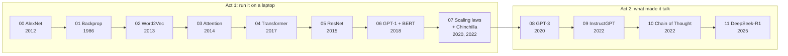
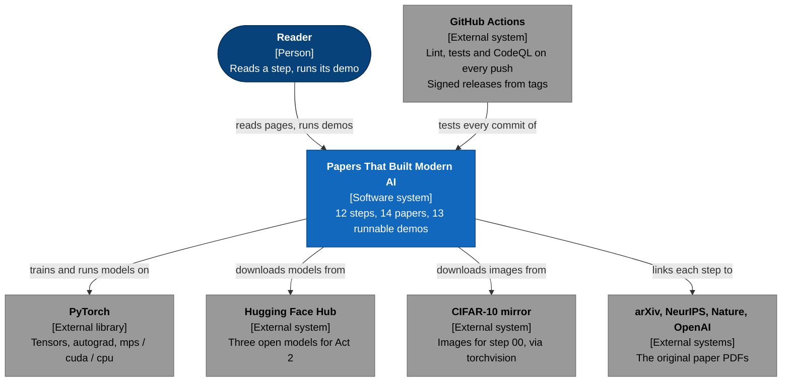
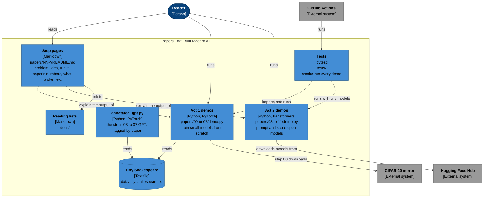
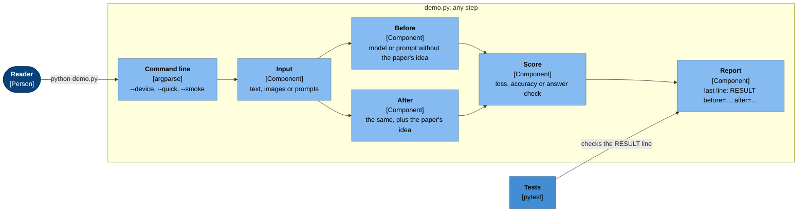

<div align="center">

# Papers That Built Modern AI

14 landmark papers from 1986 to 2025, in 12 steps that each have a short page and a demo you run on your own machine.

[](https://github.com/mlvpatel/papers-that-built-ai/actions/workflows/ci.yml)


[](LICENSE)
[](LICENSE-CONTENT)

[The papers](#the-14-papers) · [Architecture](#architecture-c4-model) · [The math](#the-math-behind-each-step) · [Run it](#run-it) · [Results](#results)

**[Start here: 00 AlexNet](papers/00-alexnet/)**

</div>

You know these 8 papers: Word2Vec, the Transformer, GPT-1, BERT, the scaling laws, GPT-3, InstructGPT and Chain of Thought. Here are the 6 around them that nobody tells you about, and the code that shows why each one had to exist.



Act 1 trains small models from scratch. Act 2 runs three small open models. Each step is one folder with a page in the same five parts (what was broken, the idea, run it, the paper's own numbers, what broke next) and one file you can run. Every demo prints a before and an after that differ in the paper's one idea, so you see the problem and the fix on your own machine.

## The 14 papers

Twelve steps, numbered 00 to 11. Steps 06 and 07 each cover two papers, so the table has 14 rows.

| Step | Year | Paper | Authors | What it made possible |
|---|---|---|---|---|
| [00](papers/00-alexnet/) | 2012 | [ImageNet Classification with Deep Convolutional Neural Networks](https://papers.nips.cc/paper/2012/hash/c399862d3b9d6b76c8436e924a68c45b-Abstract.html) (AlexNet) | Krizhevsky, Sutskever, Hinton. NeurIPS | A network learns its own image filters on GPUs. ImageNet top-5 error fell from 25.7% to 17.0% |
| [01](papers/01-backprop/) | 1986 | [Learning representations by back-propagating errors](https://doi.org/10.1038/323533a0) | Rumelhart, Hinton, Williams. Nature | The output error flows back through every layer, so hidden units learn their own features. Every model in this repo was trained this way |
| [02](papers/02-word2vec/) | 2013 | [Efficient Estimation of Word Representations in Vector Space](https://arxiv.org/abs/1301.3781) (Word2Vec) | Mikolov, Chen, Corrado, Dean. Google | Words become vectors learned from raw text, and vector arithmetic answers analogies: King − Man + Woman ≈ Queen |
| [03](papers/03-attention/) | 2014 | [Neural Machine Translation by Jointly Learning to Align and Translate](https://arxiv.org/abs/1409.0473) | Bahdanau, Cho, Bengio. ICLR 2015 | The decoder looks back at every input word with learned weights, instead of one fixed-length summary |
| [04](papers/04-transformer/) | 2017 | [Attention Is All You Need](https://arxiv.org/abs/1706.03762) (Transformer) | Vaswani, Shazeer, Parmar, Uszkoreit, Jones, Gomez, Kaiser, Polosukhin. Google, NeurIPS | Self-attention replaces recurrence, so every position reaches every other in one step and training runs in parallel |
| [05](papers/05-resnet/) | 2015 | [Deep Residual Learning for Image Recognition](https://arxiv.org/abs/1512.03385) (ResNet) | He, Zhang, Ren, Sun. Microsoft Research | Skip connections let a 152-layer network train. Adding depth made models better instead of worse |
| [06](papers/06-pretraining/) | 2018 | [Improving Language Understanding by Generative Pre-Training](https://cdn.openai.com/research-covers/language-unsupervised/language_understanding_paper.pdf) (GPT-1) | Radford, Narasimhan, Salimans, Sutskever. OpenAI | Learn the language from unlabeled text first, then the task. GPT-1 scored 74.7 with pre-training and 59.9 without |
| [06](papers/06-pretraining/) | 2018 | [BERT: Pre-training of Deep Bidirectional Transformers for Language Understanding](https://arxiv.org/abs/1810.04805) | Devlin, Chang, Lee, Toutanova. Google | The same recipe with a different pre-training task: hide some words and predict them from both sides, where GPT-1 reads only left to right |
| [07](papers/07-scaling/) | 2020 | [Scaling Laws for Neural Language Models](https://arxiv.org/abs/2001.08361) | Kaplan et al. OpenAI | Loss falls along a power law as parameters, data and compute grow, so a big run can be predicted from small ones |
| [07](papers/07-scaling/) | 2022 | [Training Compute-Optimal Large Language Models](https://arxiv.org/abs/2203.15556) (Chinchilla) | Hoffmann et al. DeepMind | For a fixed budget, grow model size and training data in equal proportion. A 70B model beat the 280B Gopher |
| [08](papers/08-gpt3/) | 2020 | [Language Models are Few-Shot Learners](https://arxiv.org/abs/2005.14165) (GPT-3) | Brown et al. OpenAI | A 175B model picks up a task from examples in the prompt, with no weight updates |
| [09](papers/09-instructgpt/) | 2022 | [Training language models to follow instructions with human feedback](https://arxiv.org/abs/2203.02155) (InstructGPT) | Ouyang et al. OpenAI | A reward model learned from human rankings steers the model. People preferred the 1.3B InstructGPT to the 175B GPT-3 |
| [10](papers/10-chain-of-thought/) | 2022 | [Chain-of-Thought Prompting Elicits Reasoning in Large Language Models](https://arxiv.org/abs/2201.11903) | Wei et al. Google | Writing the steps before the answer took PaLM 540B from 18% to 57% on grade-school math |
| [11](papers/11-deepseek-r1/) | 2025 | [DeepSeek-R1: Incentivizing Reasoning Capability in LLMs via Reinforcement Learning](https://arxiv.org/abs/2501.12948) | DeepSeek-AI | Reinforcement learning on answers a rule can check teaches long reasoning with no human-written traces |

Every number above comes from the paper and is cited with its table or page on the step's page. PDF links for all 14 are in the [reading list](docs/reading-list.md), and the [full list of 45 papers](docs/all-45-papers.md) covers the ones this repo leaves out.

## Architecture (C4 model)

The repo is described at three [C4](https://c4model.com/) levels: who uses it and what it depends on, what it is made of, and what is inside one demo.

### Level 1: system context



### Level 2: containers



### Level 3: components of one demo

Every `demo.py` has the same shape, whether it trains a network (Act 1) or prompts an open model (Act 2). Each one is a single file you can read on its own, so small helpers such as the device choice, batching and model loading are copied into every demo on purpose rather than shared.



## The math behind each step

Each paper's core equation, in the paper's own notation where it has one, with the logic of why it works. Click a step to open it.

<details>
<summary><b>00 AlexNet</b>: one small filter, reused at every position</summary>

A convolutional layer computes each output from a small window of the input, with the same weights $`W`$ at every position $`(i, j)`$, then applies the ReLU $`f(x) = \max(0, x)`$ (section 3.1):

```math
y_{i,j,k} = \max\Big(0,\; b_k + \sum_{c}\sum_{u,v} W_{k,c,u,v}\; x_{i+u,\,j+v,\,c}\Big)
```

The logic is in the two assumptions the paper names on page 1: nearby pixels depend on each other most (so the window is small), and a pattern means the same thing wherever it appears (so the weights are shared). A 3 by 3 filter bank from $`C_{in}`$ to $`C_{out}`$ channels has $`9\,C_{in} C_{out}`$ weights whatever the image size, while a fully connected layer between two feature maps needs one weight per pair of positions. Fewer parameters is why it trains, and GPUs are why it trains fast: five to six days on two GTX 580s (page 7).

</details>

<details>
<summary><b>01 Backpropagation</b>: the chain rule, run backwards</summary>

Measure the error at the output, here the squared difference between the output $`y`$ and the target $`d`$, summed over output units $`j`$ and cases $`c`$:

```math
E = \tfrac{1}{2}\sum_{c}\sum_{j}\big(y_{j,c} - d_{j,c}\big)^2
```

For a unit with total input $`z_j`$ and activation $`f`$, its error signal $`\delta_j = \partial E / \partial z_j`$ comes from the output for the last layer, and from the layer above for every hidden layer:

```math
\delta_j^{\text{output}} = (y_j - d_j)\, f'(z_j) \qquad\qquad \delta_j^{\text{hidden}} = f'(z_j)\sum_k w_{jk}\,\delta_k
```

Every weight then moves downhill by a step $`\varepsilon`$:

```math
\Delta w_{ij} = -\varepsilon\,\frac{\partial E}{\partial w_{ij}} = -\varepsilon\,\delta_j\, y_i
```

The logic: each layer's $`\delta`$ is reused to compute the layer below, so one backward pass costs about as much as one forward pass, however deep the network. Hidden units now get a training signal of their own, which is what lets them invent features (abstract). Written here in modern notation.

</details>

<details>
<summary><b>02 Word2Vec</b>: predict the neighbours, and the vectors appear</summary>

Skip-gram maximises the average log probability of each word's neighbours within a window of size $`c`$, with a softmax over the whole vocabulary of $`W`$ words. The objective is written out in the authors' follow-up paper ([Mikolov et al. 2013b](https://arxiv.org/abs/1310.4546), Equations 1 and 2):

```math
\frac{1}{T}\sum_{t=1}^{T}\;\sum_{-c\le j\le c,\; j\ne 0}\log p(w_{t+j}\mid w_t), \qquad p(w_O\mid w_I) = \frac{\exp\big({v'_{w_O}}^{\top} v_{w_I}\big)}{\sum_{w=1}^{W}\exp\big({v'_{w}}^{\top} v_{w_I}\big)}
```

The denominator touches every word in the vocabulary. Negative sampling, which the demo uses, replaces it with $`k`$ random words drawn from a noise distribution $`P_n`$ (same paper, Equation 4):

```math
\log\sigma\big({v'_{w_O}}^{\top} v_{w_I}\big) + \sum_{i=1}^{k}\mathbb{E}_{w_i\sim P_n(w)}\Big[\log\sigma\big(-{v'_{w_i}}^{\top} v_{w_I}\big)\Big]
```

The logic: words used in the same contexts get pushed towards the same output vectors, so their input vectors end up close. Analogies then become vector arithmetic, answered by the nearest word by cosine distance (pages 2 and 5):

```math
\arg\max_{x}\;\cos\big(v_x,\; v_{\text{king}} - v_{\text{man}} + v_{\text{woman}}\big) = \text{queen}
```

</details>

<details>
<summary><b>03 Attention</b>: a separate context for every output word</summary>

The encoder keeps one annotation $`h_j`$ per input word. Before writing output word $`i`$, the decoder in state $`s_{i-1}`$ scores every annotation, turns the scores into weights and reads their weighted sum (Equations 5 and 6; the alignment model is in Appendix A.1.2):

```math
e_{ij} = v_a^{\top}\tanh\big(W_a s_{i-1} + U_a h_j\big), \qquad \alpha_{ij} = \frac{\exp(e_{ij})}{\sum_{k=1}^{T_x}\exp(e_{ik})}, \qquad c_i = \sum_{j=1}^{T_x}\alpha_{ij}\, h_j
```

The logic: the weights $`\alpha_{ij}`$ sum to 1, so $`c_i`$ is the expected annotation under a soft alignment, and because it is differentiable the alignment is learned with everything else (page 4). Fix $`c_i`$ to the encoder's final state and the model turns back into the plain encoder-decoder (page 14), which is exactly the demo's model without attention. The price is $`T_x \times T_y`$ scores per sentence pair (page 12).

</details>

<details>
<summary><b>04 Transformer</b>: scaled dot-product attention, in parallel</summary>

Pack the queries, keys and values into matrices and compute all positions at once (Equation 1, page 4):

```math
\mathrm{Attention}(Q, K, V) = \mathrm{softmax}\Big(\frac{QK^{\top}}{\sqrt{d_k}}\Big)V
```

Run $`h`$ of these side by side on learned projections and join them (page 5):

```math
\mathrm{MultiHead}(Q,K,V) = \mathrm{Concat}(\mathrm{head}_1,\ldots,\mathrm{head}_h)\,W^O, \qquad \mathrm{head}_i = \mathrm{Attention}\big(QW_i^Q,\; KW_i^K,\; VW_i^V\big)
```

Why divide by $`\sqrt{d_k}`$: if the components of $`q`$ and $`k`$ are independent with mean 0 and variance 1, their dot product has variance $`d_k`$, which pushes the softmax into regions with tiny gradients (footnote 4, page 4). In a language model, future positions are set to $`-\infty`$ before the softmax so a token cannot see what comes after it (page 5).

The paper's case against recurrence is Table 1 (page 6), for sequence length $`n`$ and width $`d`$:

| Layer | Work per layer | Sequential steps | Longest path between two positions |
|---|---|---|---|
| Self-attention | O(n² · d) | O(1) | O(1) |
| Recurrent | O(n · d²) | O(n) | O(n) |

</details>

<details>
<summary><b>05 ResNet</b>: learn the change, not the whole mapping</summary>

If a few layers should compute $`H(x)`$, let them learn the residual $`\mathcal{F}(x) = H(x) - x`$ instead and add the input back through a shortcut (Equation 1, page 3):

```math
y = \mathcal{F}\big(x, \lbrace W_i\rbrace\big) + x
```

The logic: a deeper network should never be worse than a shallower one, since the extra layers could copy their input, but plain networks fail to learn that copy (page 1). With a shortcut, copying only needs $`\mathcal{F} \to 0`$, and the shortcut adds no parameters (page 2). Differentiating the block shows why the signal survives depth:

```math
\frac{\partial L}{\partial x} = \frac{\partial L}{\partial y}\Big(1 + \frac{\partial \mathcal{F}}{\partial x}\Big)
```

The $`1`$ carries the gradient straight through every block, whatever the layers inside do.

</details>

<details>
<summary><b>06 GPT-1 and BERT</b>: pre-train on raw text, then fine-tune</summary>

GPT-1 first maximises the likelihood of each token given the $`k`$ before it, over an unlabeled corpus $`\mathcal{U}`$ (Equation 1, page 3):

```math
L_1(\mathcal{U}) = \sum_i \log P\big(u_i \mid u_{i-k},\ldots,u_{i-1};\,\Theta\big)
```

Then it fine-tunes on a labeled set $`\mathcal{C}`$, keeping language modelling as an auxiliary loss with weight $`\lambda`$ (Equations 4 and 5, page 3):

```math
L_2(\mathcal{C}) = \sum_{(x,y)}\log P\big(y \mid x^1,\ldots,x^m\big), \qquad L_3(\mathcal{C}) = L_2(\mathcal{C}) + \lambda\, L_1(\mathcal{C})
```

BERT changes only the pre-training task. It hides a random 15% of the tokens, the set $`M`$, and predicts them from both sides (page 4). The paper gives this loss in words; here it is in modern notation:

```math
\mathcal{L}_{\text{MLM}} = -\sum_{i\in M}\log P\big(x_i \mid x_{\setminus M}\big)
```

The logic: predicting text forces the model to learn grammar, facts and meaning, and none of it needs labels. The task then only has to adapt a model that already knows the language, which is why GPT-1 scored 74.7 with pre-training and 59.9 without (Table 5, page 8).

</details>

<details>
<summary><b>07 Scaling laws and Chinchilla</b>: power laws, and how to split a budget</summary>

Kaplan et al. fit test loss against $`N`$, the parameters without embeddings, as a power law (Equation 1.1, page 4), and count training compute as about $`6N`$ operations per token, $`2N`$ forward and $`4N`$ backward (page 7):

```math
L(N) = \Big(\frac{N_c}{N}\Big)^{\alpha_N}, \quad \alpha_N \approx 0.076 \qquad\qquad C \approx 6ND
```

Doubling $`N`$ multiplies the loss by $`2^{-\alpha_N} \approx 0.95`$ (page 5). Their best model size grew as $`N \propto C^{0.73}`$ (page 5), so most of a bigger budget went into parameters.

Chinchilla models the loss as a function of both parameters and training tokens $`D`$ (Equation 2, page 6):

```math
\hat{L}(N, D) = E + \frac{A}{N^{\alpha}} + \frac{B}{D^{\beta}}
```

$`E`$ is the entropy of natural text, the second term is the cost of a finite model and the third the cost of finite training (page 6). Minimising $`\hat{L}`$ under $`6ND = C`$ gives (Equation 4, page 7):

```math
N_{opt} \propto C^{a}, \quad D_{opt} \propto C^{b}, \qquad a = \frac{\beta}{\alpha + \beta}, \quad b = \frac{\alpha}{\alpha + \beta}
```

The logic: $`a + b = 1`$, so when $`\alpha`$ and $`\beta`$ are close, model size and data each grow as about $`\sqrt{C}`$. Chinchilla's three methods put $`a`$ at 0.46 to 0.50, against Kaplan's 0.73 (Table 2, page 8).

</details>

<details>
<summary><b>08 GPT-3</b>: the task lives in the prompt</summary>

GPT-3 is a next-token predictor. In-context learning puts a task description and $`k`$ solved examples in front of a new input $`x`$ and reads off the most likely completion, with the weights $`\theta`$ frozen:

```math
\hat{y} = \arg\max_{y}\; P_{\theta}\big(y \mid \text{description},\; (x_1, y_1),\ldots,(x_k, y_k),\; x\big)
```

$`k = 0`$ is zero-shot, $`k = 1`$ one-shot, and few-shot uses as many as fit, typically 10 to 100 (pages 5 and 6).

The logic: no gradient step happens. The examples only change what the model conditions on, so one model serves every task. The effect grows with size: across 42 benchmarks, few-shot accuracy climbs faster with model size than zero-shot accuracy does (Figure 1.3, page 5).

</details>

<details>
<summary><b>09 InstructGPT</b>: a reward model from human rankings, then PPO</summary>

Labelers rank $`K`$ answers to a prompt $`x`$. The reward model $`r_{\theta}`$ learns to score the preferred answer $`y_w`$ above the other $`y_l`$ in every one of the $`\binom{K}{2}`$ pairs (Equation 1, page 8):

```math
\mathrm{loss}(\theta) = -\frac{1}{\binom{K}{2}}\;\mathbb{E}_{(x,\, y_w,\, y_l)\sim D}\Big[\log\sigma\big(r_{\theta}(x, y_w) - r_{\theta}(x, y_l)\big)\Big]
```

The policy is then trained with PPO to maximise reward, with a KL penalty that keeps it close to the supervised model and a term that keeps fitting the pre-training data (Equation 2, page 9):

```math
\mathrm{objective}(\phi) = \mathbb{E}_{(x,y)\sim D_{\pi_{\phi}^{\mathrm{RL}}}}\Big[r_{\theta}(x,y) - \beta\log\frac{\pi_{\phi}^{\mathrm{RL}}(y\mid x)}{\pi^{\mathrm{SFT}}(y\mid x)}\Big] + \gamma\;\mathbb{E}_{x\sim D_{\mathrm{pretrain}}}\Big[\log \pi_{\phi}^{\mathrm{RL}}(x)\Big]
```

The logic: the difference in rewards is the log odds that a labeler prefers one answer (page 8), so the reward model turns a set of rankings into a score for any answer. The $`\beta`$ term stops the policy from drifting into text that fools the reward model, and the $`\gamma`$ term fixes the drop on public benchmarks (page 9).

</details>

<details>
<summary><b>10 Chain of Thought</b>: generate the steps, then the answer</summary>

Each prompt example becomes a triple: question, chain of thought, answer (page 2). With exemplars $`E`$ and a new question $`q`$, the model writes a rationale $`r`$ before the answer $`a`$, so by the chain rule of probability:

```math
P(r, a \mid E, q) = P(r \mid E, q)\cdot P(a \mid E, q, r)
```

The logic: the answer is now conditioned on steps the model has already written, and each step is a small computation it can get right. The tokens themselves are not the reason. When the model writes a row of dots as long as the equation it needs, it does about as well as with no help (page 6). The gain appears only at around 100B parameters (page 4).

</details>

<details>
<summary><b>11 DeepSeek-R1</b>: GRPO with rewards a rule can check</summary>

For each question $`q`$, GRPO samples a group of $`G`$ answers from the current policy and scores each one against the others, so it needs no value model (Equations 1 and 3, page 3):

```math
\mathcal{J}_{GRPO}(\theta) = \mathbb{E}\Big[\frac{1}{G}\sum_{i=1}^{G}\Big(\min\Big(\frac{\pi_{\theta}(o_i\mid q)}{\pi_{\theta_{old}}(o_i\mid q)}A_i,\; \mathrm{clip}\Big(\frac{\pi_{\theta}(o_i\mid q)}{\pi_{\theta_{old}}(o_i\mid q)},\, 1-\varepsilon,\, 1+\varepsilon\Big)A_i\Big) - \beta\, \mathbb{D}_{KL}\big(\pi_{\theta}\,\Vert\,\pi_{ref}\big)\Big)\Big]
```

```math
A_i = \frac{r_i - \mathrm{mean}(r_1,\ldots,r_G)}{\mathrm{std}(r_1,\ldots,r_G)}
```

The reward for R1-Zero is a rule, not a model: a correct final answer plus the right format, with equal weight (Equation 4, page 4):

```math
\mathit{Reward}_{rule} = \mathit{Reward}_{acc} + \mathit{Reward}_{format}
```

The logic: an answer earns a positive advantage only by beating the other answers to the same question, and a correct answer can be checked by a rule or a compiler, so there is no reward model to fool. Nothing rewards how the model reasons, yet its answers grew longer through training and it learned to re-check its work (Figure 1b and Table 2, pages 4 and 5). AIME 2024 accuracy rose from 15.6% to 77.9% (page 4).

</details>

## The whole of Act 1 in one file

[`papers/annotated_gpt.py`](papers/annotated_gpt.py) is the small GPT that steps 03 to 07 build, with every line tagged by the paper it came from. One Transformer block, without its `__init__`:

```python
class Block(nn.Module):
    def attention(self, x):
        b, t, _ = x.shape
        qkv = self.qkv(x).view(b, t, 3, HEADS, WIDTH // HEADS)  # [04 Transformer] heads
        q, k, v = qkv.permute(2, 0, 3, 1, 4)  # [04 Transformer] one q, k, v per head
        scores = q @ k.transpose(-2, -1) / math.sqrt(WIDTH // HEADS)  # [04] Eq. 1
        scores = scores.masked_fill(~self.mask[:t, :t], -math.inf)  # [04] no future
        weights = scores.softmax(-1)  # [03 Attention] weights over positions sum to 1
        out = weights @ v  # [03 Attention] weighted sum of the values
        return self.proj(out.transpose(1, 2).reshape(b, t, WIDTH))  # [04] join heads

    def forward(self, x):
        x = x + self.attention(self.ln1(x))  # [05 ResNet] add; [GPT-2, all-45 #22]
        return x + self.ff2(F.gelu(self.ff1(self.ln2(x))))  # [05] [GPT-2 #22] [06 GELU]
```

It trains on Tiny Shakespeare in 54 seconds on an Apple M5 Pro GPU, then writes its own text.

## Run it

You need Python 3.12. Act 1 runs from the repo alone, apart from CIFAR-10 for step 00 (about 170 MB). Act 2 downloads 9.6 GB of models on first use. From a clone of this repo:

```bash
python3.12 -m venv .venv
```

```bash
source .venv/bin/activate
```

```bash
pip install -r requirements.txt -c constraints.txt
```

```bash
python papers/05-resnet/demo.py
```

Each demo picks a GPU when it finds one (Apple `mps` or `cuda`) and falls back to the CPU, except step 01, whose four XOR points always run on the CPU. Pass `--device cpu`, `mps` or `cuda` to choose. On a CPU, add `--quick` for a shorter run (Act 1 only). Steps 01 to 07 work offline, since Tiny Shakespeare is in the repo; step 00 downloads CIFAR-10 on its first run.

Act 2 uses Pythia-1.4B (2.9 GB, steps 08 and 09), Qwen2.5-1.5B-Instruct (3.1 GB, steps 09 to 11) and DeepSeek-R1-Distill-Qwen-1.5B (3.6 GB, step 11). Its measured peak memory is 3.9 to 5.9 GB, so a laptop with 16 GB of RAM should run it.

To run the tests and the linter as CI does, install the tools CI uses and run them from the repo root. The tests run every demo in its shortest mode, which took about 30 seconds on the Apple M5 Pro the results were measured on. The Act 2 tests download only the models' tokenizer and config files, not the weights.

```bash
pip install -r ci-tools.txt
```

```bash
python -m pytest -q
```

```bash
ruff check . && ruff format --check .
```

## Results

Measured on an Apple M5 Pro (48 GB), 16 November 2026. Each page shows the full output.

### Act 1: small models trained from scratch

| Step | Before → after | Full run, GPU | `--quick`, CPU |
|---|---|---|---|
| [00 AlexNet](papers/00-alexnet/) | Test accuracy 52.2% → 74.4% | 40 s | 76 s |
| [01 Backprop](papers/01-backprop/) | XOR solved 50% → 100% | 1 s (CPU) | same run |
| [02 Word2Vec](papers/02-word2vec/) | Pair score -0.016 → 0.258 | 12 s | 3 s |
| [03 Attention](papers/03-attention/) | Characters right at length 32: 26.0% → 94.2% | 63 s | 17 s |
| [04 Transformer](papers/04-transformer/) | Loss 1.61 → 1.72, training 29 s → 12 s | 42 s | 13 s |
| [05 ResNet](papers/05-resnet/) | Loss of a 24-block model 3.36 → 1.67 | 151 s | 106 s |
| [06 Pre-training](papers/06-pretraining/) | Picks the real line 59.8% → 91.4% | 84 s | 41 s |
| [07 Scaling](papers/07-scaling/) | Loss 2.21 → 1.66 as size grows | 106 s | 49 s |
| [annotated_gpt.py](papers/annotated_gpt.py) | Held-out loss 4.195 → 1.794 | 54 s | 35 s |

Step 04's Transformer is slightly worse after the same number of steps but trains more than twice as fast; its page explains why that speed was the paper's argument. GPU runs are not bit-for-bit repeatable, so steps 03, 05 and 06 and annotated_gpt.py can land a little differently each time. The `--quick` CPU runs repeated exactly when re-run.

### Act 2: small open models

| Step | Before → after | Full run, GPU |
|---|---|---|
| [08 GPT-3](papers/08-gpt3/) | Items right, no examples → a few examples: 3/16 → 16/16 | 12 s |
| [09 InstructGPT](papers/09-instructgpt/) | Checks passed, Pythia → Qwen Instruct: 0/3 → 3/3 | 13 s |
| [10 Chain of Thought](papers/10-chain-of-thought/) | Problems right, answer at once → step by step: 2/12 → 11/12 | 69 s |
| [11 DeepSeek-R1](papers/11-deepseek-r1/) | Problems right, Qwen step by step → R1-distill: 3/4 → 4/4 | 271 s |

## Data and license

Tiny Shakespeare (`data/tinyshakespeare.txt`, 1.1 MB) is the sample of Shakespeare's plays from Andrej Karpathy's [char-rnn](https://github.com/karpathy/char-rnn) project, copied unchanged. The plays are in the public domain.

Code under the [MIT License](LICENSE). The written pages under [CC BY 4.0](LICENSE-CONTENT).
