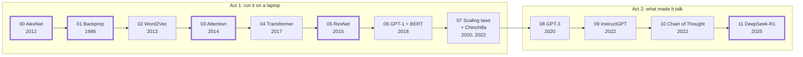

# Papers That Built Modern AI

You know these 6 papers: Word2Vec, the Transformer, GPT-1 and BERT, the scaling laws and GPT-3, InstructGPT, and Chain of Thought. Here are the 6 around them that nobody tells you about, and the code that shows why each one had to exist.



Thick borders mark the papers usually left off the list. The sixth, Chinchilla, shares step 07 with the scaling laws it corrected. Act 1's demos run today; Act 2's pages are here and its demos come in v1.1.

**[Start here: 00 AlexNet](papers/00-alexnet/)**

Each step is one folder with a short page in the same five parts (what was broken, the idea, run it, the paper's own numbers, what broke next) and one file you can run. Every demo prints a before and an after that differ in the paper's one idea, so you see the problem and the fix on your own machine. Each page ends with the problem the next paper solved.

## The 14 papers

The order follows the story, not the calendar: ResNet comes after the Transformer because that is where the model gets deep enough to need it.

| Step | Year | Paper | Why it had to exist | Usually on the list? |
|---|---|---|---|---|
| [00](papers/00-alexnet/) | 2012 | [AlexNet](https://papers.nips.cc/paper/2012/hash/c399862d3b9d6b76c8436e924a68c45b-Abstract.html) | A network learns its own image filters, trained on GPUs | No |
| [01](papers/01-backprop/) | 1986 | [Backpropagation](https://doi.org/10.1038/323533a0) | Tells every hidden weight which way to move | No |
| [02](papers/02-word2vec/) | 2013 | [Word2Vec](https://arxiv.org/abs/1301.3781) | Words become vectors, and related words sit close | Yes |
| [03](papers/03-attention/) | 2014 | [Attention (Bahdanau et al.)](https://arxiv.org/abs/1409.0473) | Look back at every input word, not one squeezed summary | No |
| [04](papers/04-transformer/) | 2017 | [Attention Is All You Need](https://arxiv.org/abs/1706.03762) | Keep attention, drop the slow recurrent network | Yes |
| [05](papers/05-resnet/) | 2015 | [ResNet](https://arxiv.org/abs/1512.03385) | Skip connections let a deep model keep learning | No |
| [06](papers/06-pretraining/) | 2018 | [GPT-1](https://cdn.openai.com/research-covers/language-unsupervised/language_understanding_paper.pdf) and [BERT](https://arxiv.org/abs/1810.04805) | Learn the language from raw text first, then the task | Yes |
| [07](papers/07-scaling/) | 2020 | [Scaling laws](https://arxiv.org/abs/2001.08361) | Loss falls predictably as models, data and compute grow | Yes |
| [07](papers/07-scaling/) | 2022 | [Chinchilla](https://arxiv.org/abs/2203.15556) | Grow model and data together, not the model alone | No |
| [08](papers/08-gpt3/) | 2020 | [GPT-3](https://arxiv.org/abs/2005.14165) | Show a few examples in the prompt instead of retraining | Yes |
| [09](papers/09-instructgpt/) | 2022 | [InstructGPT](https://arxiv.org/abs/2203.02155) | Train the model on what people prefer | Yes |
| [10](papers/10-chain-of-thought/) | 2022 | [Chain of Thought](https://arxiv.org/abs/2201.11903) | Write the steps before the answer | Yes |
| [11](papers/11-deepseek-r1/) | 2025 | [DeepSeek-R1](https://arxiv.org/abs/2501.12948) | Learn to reason from answers that can be checked | No |

PDF links for all 14 are in the [reading list](docs/reading-list.md). The [full list of 45 papers](docs/all-45-papers.md) covers the ones this repo leaves out.

## The whole of Act 1 in one file

[`papers/annotated_gpt.py`](papers/annotated_gpt.py) is the small GPT that steps 03 to 07 build, with every line tagged by the paper it came from. One Transformer block, without its `__init__`:

```python
class Block(nn.Module):
    def attention(self, x):
        b, t, _ = x.shape
        qkv = self.qkv(x).view(b, t, 3, HEADS, WIDTH // HEADS)  # [04 Transformer] heads
        q, k, v = qkv.permute(2, 0, 3, 1, 4)  # [04 Transformer] one q, k, v per head
        scores = q @ k.transpose(-2, -1) / math.sqrt(WIDTH // HEADS)  # [04] Eq. 1
        scores = scores.masked_fill(~self.mask[:t, :t], -math.inf)  # [04] no future
        weights = scores.softmax(-1)  # [03 Attention] weights over positions sum to 1
        out = weights @ v  # [03 Attention] weighted sum of the values
        return self.proj(out.transpose(1, 2).reshape(b, t, WIDTH))  # [04] join heads

    def forward(self, x):
        x = x + self.attention(self.ln1(x))  # [05 ResNet] add; [GPT-2, all-45 #22]
        return x + self.ff2(F.gelu(self.ff1(self.ln2(x))))  # [05] [GPT-2 #22] [06 GELU]
```

It trains on Tiny Shakespeare in 54 seconds on an Apple M5 Pro GPU, then writes its own text.

## Run it

You need Python 3.12. From a clone of this repo:

```bash
python3.12 -m venv .venv
```

```bash
source .venv/bin/activate
```

```bash
pip install -r requirements.txt
```

```bash
python papers/05-resnet/demo.py
```

Each demo picks a GPU when it finds one (Apple `mps` or `cuda`) and falls back to the CPU. On a CPU, add `--quick` for a shorter run. Steps 01 to 07 work offline, since Tiny Shakespeare is in the repo; step 00 downloads CIFAR-10 (about 170 MB) on its first run.

Measured on an Apple M5 Pro (48 GB), 15 and 16 November 2026. Each page shows the full output.

| Step | Before → after | Full run, GPU | `--quick`, CPU |
|---|---|---|---|
| [00 AlexNet](papers/00-alexnet/) | Test accuracy 52.2% → 74.4% | 50 s | 101 s |
| [01 Backprop](papers/01-backprop/) | XOR solved 50% → 100% | 1 s (CPU) | same run |
| [02 Word2Vec](papers/02-word2vec/) | Pair score -0.016 → 0.258 | 21 s | 7 s |
| [03 Attention](papers/03-attention/) | Characters right at length 32: 24.5% → 96.7% | 94 s | 25 s |
| [04 Transformer](papers/04-transformer/) | Loss 1.61 → 1.72, training 40 s → 17 s | 59 s | 19 s |
| [05 ResNet](papers/05-resnet/) | Loss of a 24-block model 3.36 → 1.67 | 214 s | 149 s |
| [06 Pre-training](papers/06-pretraining/) | Picks the real line 59.8% → 91.4% | 155 s | 70 s |
| [07 Scaling](papers/07-scaling/) | Loss 2.21 → 1.66 as size grows | 173 s | 71 s |
| [annotated_gpt.py](papers/annotated_gpt.py) | Held-out loss 4.195 → 1.814 | 54 s | 39 s |

Step 04's Transformer is slightly worse after the same number of steps but trains more than twice as fast; the page explains why that speed was the paper's argument.

## License

Code under the [MIT License](LICENSE). The written pages under [CC BY 4.0](LICENSE-CONTENT).
