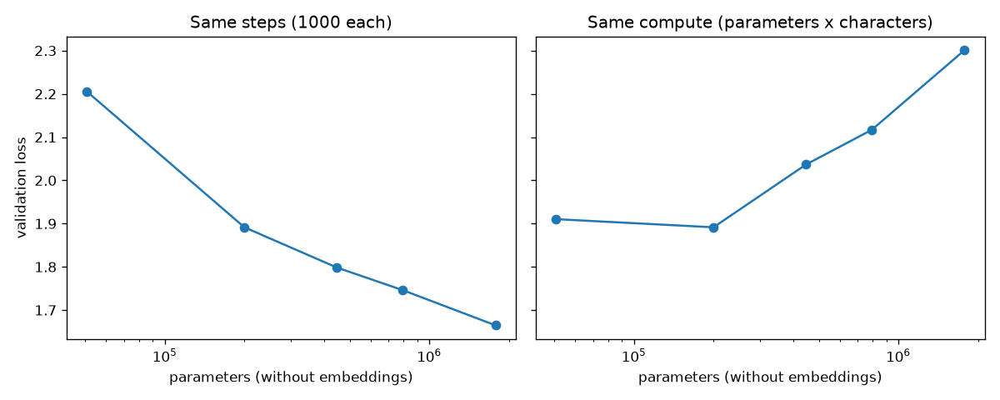

# 07 Scaling laws: how big, and for how long

Papers: [Scaling Laws for Neural Language Models](https://arxiv.org/abs/2001.08361), Kaplan et al. (OpenAI, 2020). [PDF](https://arxiv.org/pdf/2001.08361). [Training Compute-Optimal Large Language Models](https://arxiv.org/abs/2203.15556) (Chinchilla), Hoffmann et al. (DeepMind, 2022). [PDF](https://arxiv.org/pdf/2203.15556)

## What was broken

After step 06, a model can learn from any amount of raw text. That leaves practical questions: how big should the model be, how much text should it read, and how should a fixed budget be split between the two? Getting this wrong is expensive, because a large model can usually be trained only once (Chinchilla, page 1).

## The idea

Measure it. Kaplan et al. trained Transformers from a thousand to a billion parameters (Figure 2, page 4) and found that loss falls along a smooth power law as model size, data and compute grow. So the result of a big run can be predicted from small ones. Their advice for a fixed budget was to put most of it into model size.

Chinchilla revisited that advice with over 400 models (page 1). With compute held fixed, loss against model size has a clear valley (Figure 3, page 6): too small and the model runs out of capacity, too big and it sees too little data. Their conclusion was to grow model size and training data in equal proportion.

The demo counts compute as parameters times data seen. The papers multiply that by 6 for the forward and backward passes (Kaplan, pages 6 and 7), a constant that does not change which size wins. Every size gets the same budget:

```python
budget = size(vocab, BUDGET_WIDTH) * steps  # parameters x steps
budget_steps = max(1, round(budget / n))  # smaller models get more steps
```

## Run it

```bash
python papers/07-scaling/demo.py
```

The demo trains five widths of the step 06 model on Tiny Shakespeare. First every size gets the same 1,000 steps (Kaplan). Then every size gets the same compute, equal to the 64-wide model's 1,000 steps, so the small models train longer and the big ones shorter (Chinchilla). Lower validation loss is better.

Measured on an Apple M5 Pro (48 GB) GPU, 16 November 2026:

```text
width    params | same steps: steps   loss | same compute: steps   loss
   32    50,816 |              1000  2.205 |                3935  1.910
   64   199,936 |              1000  1.891 |                1000  1.891
   96   447,360 |              1000  1.798 |                 447  2.037
  128   793,088 |              1000  1.746 |                 252  2.117
  192 1,779,456 |              1000  1.665 |                 112  2.301
RESULT before=2.21 after=1.66 seconds=106 device=mps best_size_at_fixed_compute=199936
```



A full run saves its own plot over this `scaling.png`, so `git status` shows it as changed afterwards. `--quick` and `--smoke` runs leave it alone.

With the same steps, every bigger model is better. With the same compute, the best model is the 64-wide one with about 200,000 parameters, not the biggest: the largest model gets only 112 steps and finishes worst. The small side of the valley is shallow. The 32-wide model is 0.02 behind, which is within the run-to-run noise Kaplan et al. report for their own models (0.05, Figure 22, page 26).

On a CPU, use `--quick` (250 steps per size). With a budget that small the smallest model comes out best, so only the large side of the valley shows:

```text
RESULT before=2.54 after=2.02 seconds=49 device=cpu best_size_at_fixed_compute=50816
```

## The paper's numbers

Kaplan et al. fit loss against model size N, counted without embeddings, as `L(N) = (N_c / N)^0.076` (Equation 1.1, page 4). Doubling the parameters multiplies the loss by about 0.95 (page 5), and some of the trends hold across more than seven orders of magnitude (page 1). For a growing budget they found the best model size grows as compute to the power 0.73 (page 5).

Chinchilla's fits put that exponent at 0.46 to 0.50, against Kaplan's 0.73 (Table 2, page 8), so model size and data should grow together. They tested it by spending Gopher's compute on a smaller model trained on more text (Table 1, page 3; page 9):

| Model | Parameters | Training tokens |
|---|---|---|
| Gopher | 280 billion | 300 billion |
| Chinchilla | 70 billion | 1.4 trillion |

With the same compute, Chinchilla reached 67.5% average accuracy on the MMLU benchmark, more than 7% better than Gopher (page 1).

## What broke next

Act 1 ends here: the model from steps 04 to 07, with every line tagged by the paper it came from, is in [annotated_gpt.py](../annotated_gpt.py). Act 2 starts with what happened when OpenAI scaled this recipe up to GPT-3, at 175 billion parameters (Chinchilla, Table 1, page 3): [step 08](../08-gpt3/).
